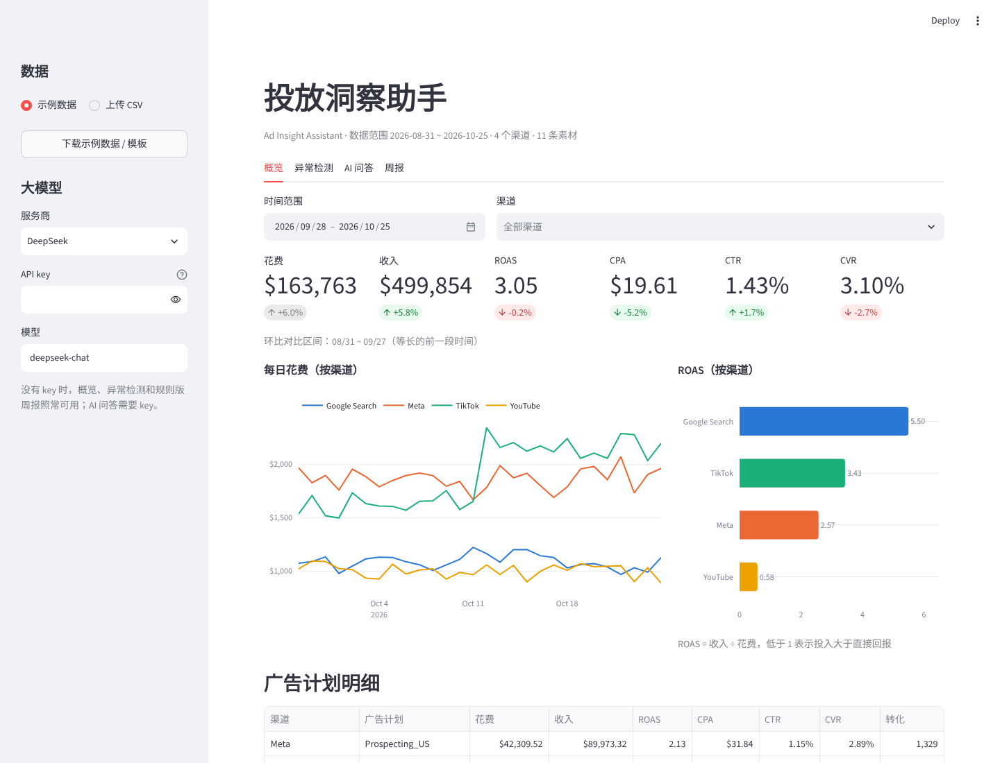
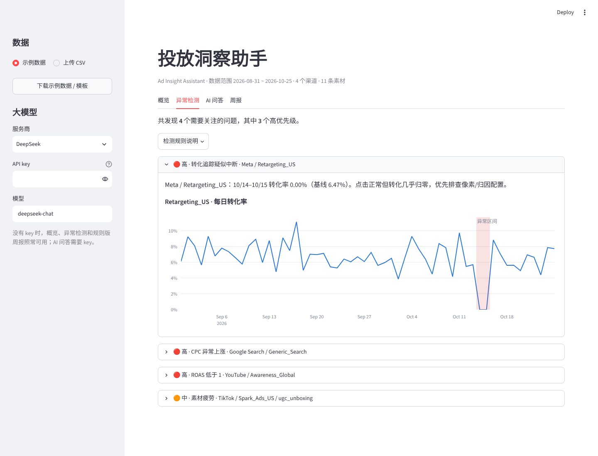

# 投放洞察助手 · Ad Insight Assistant

一个给广告投放团队用的 AI 数据分析小工具：上传跨渠道投放数据，自动做异常检测，用自然语言提问，一键生成客户周报。

**在线体验：** `<部署后把 Streamlit 链接贴在这里>`



## 解决什么问题

投放优化师每天要盯 Meta、Google、TikTok、YouTube 好几个后台，常见的痛点是：

- 追踪断了、竞品抬价、素材疲劳这类问题，往往要等几天后看周报才发现
- 业务同事想问一个"上周哪个渠道最亏"，得等分析师拉数
- 每周给客户写周报，大量时间花在复制数字和拼表格上

这个工具把这三件事自动化：**规则引擎先把问题找出来，大模型负责回答问题和写报告。**

## 功能

| 页面 | 做什么 | 需要 API key 吗 |
|---|---|---|
| 概览 | 核心指标 + 环比、每日花费趋势、分渠道 ROAS、广告计划明细 | 不需要 |
| 异常检测 | 自动识别转化追踪中断、CPC 异常上涨、素材疲劳、ROAS < 1，并附走势图 | 不需要 |
| AI 问答 | 用中文提问，AI 调用分析函数取数后给出结论和建议，每一步可展开查看 | 需要 |
| 周报 | 选一周，生成给客户看的 Markdown 周报，可下载 | 不需要（AI 版需要） |



## 设计思路

**1. 数字由代码算，大模型只负责"理解问题"和"解读结果"**

大模型做算术并不可靠，一个 ROAS 算错就可能导致预算调错方向。所以 AI 问答用的是 function calling：
我预先写好了 `query_metrics`、`compare_periods`、`list_anomalies` 三个分析函数，
模型决定调哪个、传什么参数，计算交给 pandas，结果再回给模型组织成结论。
这样做有三个好处：数字可复现、可以写单元测试、不用让模型执行任意代码。
回答下方能展开"分析过程"，看到模型调了哪些函数、拿到了哪些数，方便核对。

**2. 比率指标先汇总再相除**

CTR、CVR、ROAS 等都按 `sum(分子) / sum(分母)` 计算，不对日级比率求平均，避免小样本日子把结果带偏。

**3. 异常检测考虑了小样本噪声**

一个广告计划一天也就几十个转化，日级转化率本身波动很大，直接用 z 分数要么漏报、要么误报。
所以转化类异常用的是泊松检验：按过去 14 天中位转化率推算今天"应该"有多少转化，实际值低到概率 < 0.1% 才报警。
CPC 用中位数 + MAD 的稳健 z 分数，并且要求持续 2 天以上，过滤掉单日波动。
在 30 组不同随机种子的模拟数据上，4 类埋入的问题都 30/30 检出。

**4. 没有 API key 也能用**

概览、异常检测、规则模板版周报都不依赖大模型。这样演示零成本，接入大模型后再解锁问答和 AI 版周报。

**5. 兼容多家大模型**

走 OpenAI 兼容接口，侧边栏可以切换 DeepSeek / OpenAI / 通义千问或自定义地址。

## 项目结构

```
├── app.py                  # Streamlit 界面
├── analytics.py            # 指标计算、异常检测、周报统计（纯 pandas，可单测）
├── llm.py                  # 工具定义、问答循环、周报撰写
├── data/sample_ad_data.csv # 模拟数据
├── scripts/generate_data.py# 模拟数据生成脚本
└── tests/                  # 单元测试（含用假客户端测试问答流程）
```

## 本地运行

```bash
pip install -r requirements.txt
streamlit run app.py
```

运行测试：

```bash
pip install pytest
python -m pytest tests
```

想在本地默认带上 API key，可以把 `.streamlit/secrets.toml.example` 复制成 `.streamlit/secrets.toml` 再填 key（这个文件已经在 `.gitignore` 里，不会被传上 GitHub）。

## 数据说明

`data/sample_ad_data.csv` 是用 `scripts/generate_data.py` **模拟生成**的，不是真实客户数据。
覆盖 2026-08-31 ~ 2026-10-25 共 8 周、4 个渠道、11 条素材，并故意埋入了几个常见问题：

- Meta 再营销计划 10/14–10/15 点击正常但转化归零（模拟像素故障）
- Google 泛词搜索 10/05 那一周 CPC 上涨约 65%（模拟竞品抬价）
- TikTok 素材 `ugc_unboxing` 点击率持续下滑（模拟素材疲劳）
- YouTube 品牌曝光计划 ROAS 长期低于 1

也可以上传自己的 CSV，字段要求：`date, channel, campaign, creative, spend, impressions, clicks, conversions, revenue`，`market` 可选。

## 接下来可以做

- 直接对接 Meta / Google Ads API 拉数，替代手动上传
- 异常检测结果定时推送到飞书 / 企业微信
- 加入预算重分配的模拟器（基于各渠道边际 ROAS）
